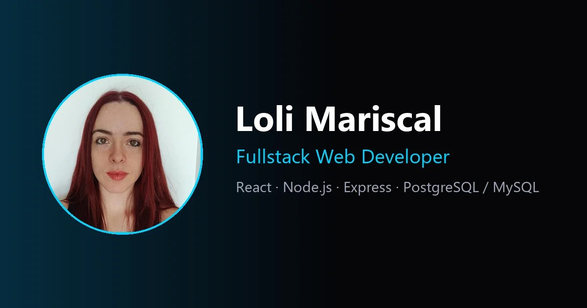

# Loli Mariscal · Portfolio

Portfolio personal de **Loli Mariscal**, desarrolladora Fullstack (React, Node.js, Express, PostgreSQL/MySQL).

🔗 **Web:** https://portfolio-loli-mariscal.vercel.app/  
💼 **LinkedIn:** https://www.linkedin.com/in/loli-mariscal-gonzalez/



## Qué incluye

- Proyectos con galería de capturas, enlaces a código y demo cuando son públicos.
- Experiencia, formación y habilidades.
- Bilingüe (ES/EN) y modo claro/oscuro.
- CV descargable en los dos idiomas.

## Stack

- **React 19** + **Vite**
- **React Router** (HashRouter)
- **CSS propio**, sin librerías de UI
- Desplegado en **Vercel**

## Ejecutar en local

```bash
npm install
npm run dev
```

Otros scripts: `npm run build`, `npm run preview` y `npm run lint`.

## Estructura

```
src/
├── components/   # Navbar, Footer, GlassCard, GalleryModal…
├── context/      # Idioma (ES/EN) y tema (claro/oscuro)
├── data/         # Contenido: proyectos, experiencia, formación, skills, textos
├── pages/        # Secciones de la home y página 404
└── routes/       # Rutas
```

Todo el contenido está en `src/data/`. Para añadir un proyecto basta con añadir una entrada en `projects.js` y sus textos en `translations.js`.

## Contacto

loli.mariscal@hotmail.com
